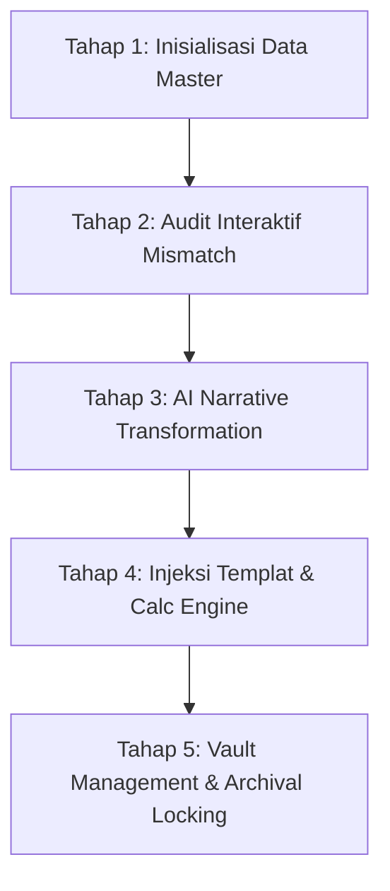
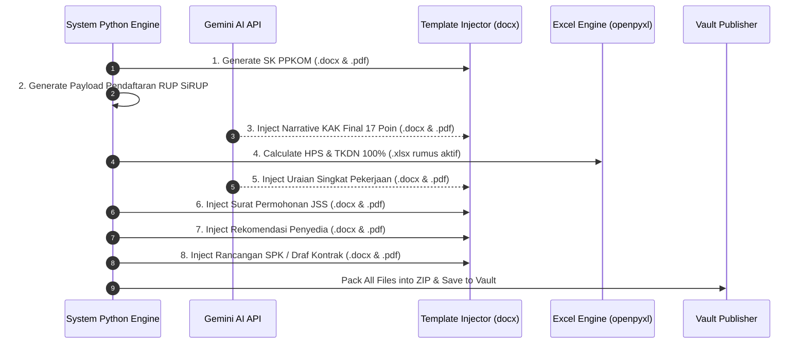

# 🗺️ USER JOURNEY & AI WORKFLOW SPECIFICATION
## Otomasi Dokumen Pengadaan Langsung (Jasa Konsultansi BPKAD Kota Yogyakarta)

---

## 📄 1. METADATA DOKUMEN & SPESIFIKASI SISTEM

```yaml
system_name: "Anam's Workspace — Procurement Automation Engine"
product_owner: "Khoirul Anam"
target_organization: "BPKAD Kota Yogyakarta"
target_year: 2026
document_scope: "Pengadaan Langsung Jasa Konsultansi (Non-Tender < Rp 100 Juta)"
ai_engine: "Gemini API (google-genai SDK)"
execution_environment: "Google Colab / n8n / Python FastAPI"
archival_vault_path: "Google Drive: /Anams_Workspace_Pengadaan/04_Output_Packages/"
```

---

## 👥 2. PERSONA & MATRIX ROLE-BASED ACCESS CONTROL (RBAC)

| Role Persona | Identitas / Entitas | Tugas Utama dalam Journey | Hak Akses Sistem |
| :--- | :--- | :--- | :--- |
| **Pengguna Anggaran (PA)** | Raden Roro Andarini, S.E., M.Si. | Otorisasi anggaran, penandatanganan SK & Kontrak | Read-Only & Final Sign |
| **Pejabat Pembuat Komitmen (PPK)** | Bambang Setyo Nugroho, S.ST. | Menyusun KAK/HPS, menetapkan penyedia, verifikasi teknis | Creator & Approval |
| **Editor / Operator System** | Khoirul Anam & Tim | Input Data Master, upload draf mentah, pemicu Colab/n8n | Full Edit & Execute |
| **AI & Python Engine** | "Si Arsiparis" (Automated Agent) | Parse DPA, audit SHBJ, Gemini rewrite KAK, calc HPS Excel, inject Word, manage vault | System Execution |

---

## 🔄 3. USER JOURNEY MAP (5 TAHAPAN UTAMA)



---

### 📍 TAHAP 1: INISIALISASI & INPUT DATA MASTER

#### 👤 Human User Action:
1. Operator membuat folder draf di Google Drive: `03_Input_Drafts/2026_KJ-01_Pajak-Hotel/`.
2. Operator mengunggah 3 file mentah acuan:
   - `DPA_2026.pdf` (Dokumen Pelaksanaan Anggaran resmi APBD).
   - `KAK_Mentah.docx` (Draf naskah awal KAK).
   - `HPS_Mentah.xlsx` (Draf usulan anggaran).
3. Operator mengunci master variabel di `Data_Master_Pengadaan.xlsx` (Master Pejabat, MAK, Pagu, Plafon SHBJ).

#### 🤖 AI & System Operation:
```json
{
  "step": "INIT_AND_EXTRACT",
  "input_files": ["Data_Master_Pengadaan.xlsx", "DPA_2026.pdf"],
  "extracted_variables": {
    "kode_mak": "5.02.04.2.01.0002.5.1.02.02.009.00006",
    "nama_pa": "Raden Roro Andarini, S.E., M.Si.",
    "nama_ppk": "Bambang Setyo Nugroho, S.ST.",
    "pagu_dpa": 325142000,
    "pagu_paket_hps": 100000000
  },
  "status": "SUCCESS"
}
```

---

### 📍 TAHAP 2: AUDIT INTERAKTIF MISMATCH & SINKRONISASI

#### 👤 Human User Action:
- Mengonfirmasi *Pop-up Modal Alert* di antarmuka jika terdapat ketidaksesuaian (*mismatch*) antara KAK, HPS, dan Plafon SHBJ Pemkot.

#### 🤖 AI & System Operation:
- **Audit Rules Matrix**:
  1. **Rule Over-Budget**: HPS > Pagu DPA → Hard Block / Peringatan Merah.
  2. **Rule Mismatch Tenaga Ahli**: Perbedaan kualifikasi S1 vs S2 atau durasi Orang-Bulan (OB) antara KAK vs HPS → Tampilkan opsi penyesuaian (Gunakan KAK / Gunakan HPS / Edit Manual).
  3. **Rule SHBJ Billing Rate**: Tarif HPS > Batas Plafon SHBJ → Auto-Adjust ke batas maksimal SHBJ atau wajib menyertakan justifikasi khusus.

```yaml
audit_result:
  mismatch_detected: true
  issues:
    - target: "Tenaga Ahli Hukum"
      kak_value: "1 Org x 2 OB"
      hps_value: "1 Org x 3 OB"
      resolution_applied: "USE_KAK_VALUE"
    - target: "Billing Rate Ahli Akuntansi"
      hps_rate: 15000000
      shbj_limit: 12500000
      resolution_applied: "AUTO_ADJUST_TO_SHBJ_LIMIT"
```

---

### 📍 TAHAP 3: AI NARRATIVE TRANSFORMATION (RESTUKTURISASI KAK 17 POIN)

#### 👤 Human User Action:
- Meninjau dan menyunting narasi pada *Rich-Text Editor* di UI jika ada poin spesifik yang ingin disempurnakan secara manual.

#### 🤖 AI & System Operation:
- **LLM Engine (Gemini API / `google-genai` SDK)** membaca KAK Mentah dan menyusun ulang naskah ke dalam **17 Poin Baku KAK Pemkot Yogyakarta**:
  1. Latar Belakang & Urgensi
  2. Maksud dan Tujuan
  3. Sasaran
  4. Lokasi Kegiatan
  5. Sumber Pendanaan & Perkiraan Biaya
  6. Ruang Lingkup & Fasilitas
  7. Hasil Produk / Output
  8. Waktu Pelaksanaan (90 Hari Kalender)
  9. Pendekatan & Metodologi
  10. Spesifikasi Teknis
  11. Peralatan & Material
  12. Jangka Waktu Penyelesaian
  13. Kebutuhan Personil (Tenaga Ahli & Kualifikasi)
  14. Jadwal Pelaksanaan Pekerjaan (Tabel Tata Kala Dinamis)
  15. Sistematika Laporan Akhir
  16. Pedoman Pengumpulan Data Lapangan
  17. Alih Pengetahuan & Hak Kekayaan Intelektual

---

### 📍 TAHAP 4: INJEKSI TEMPLAT KOP RESMI & KALKULASI SPREADSHEET

#### 👤 Human User Action:
- Memilih tombol **`[ Generate Package ]`** di UI atau mengeksekusi Cell Colab.

#### 🤖 AI & System Operation (Sekuensial 8 Dokumen Utama):



- **Formatting Rule (Strict Layout Control)**:
  - **Tabel Dinamis**: Jumlah baris/kolom pada *Tata Kala* & rincian biaya bertambah otomatis via looping.
  - **Invisible Borders (Border 0%)**: Seluruh blok TTD dan kerangka naskah baku dilapisi tabel transparan agar posisi TTD sejajar 100% dan tidak berantakan di berbagai perangkat.

---

### 📍 TAHAP 5: VAULT MANAGEMENT & ARCHIVAL LOCKING (BRANKAS OUTPUT)

#### 👤 Human User Action:
- Mengubah parameter `STATUS_DOKUMEN`:
  - `STATUS_DOKUMEN = "DRAFT"` → Selama tahap pengujian / revisi.
  - `STATUS_DOKUMEN = "ACC"` → Jika dokumen sudah disahkan dan siap dikunci.

#### 🤖 AI & System Operation (Arsiparis Engine):
- **Logika Overwrite**: Jika status `DRAFT`, skrip akan menimpa (*replace/overwrite*) file lama di folder `04_Output_Packages/` tanpa menambah nomor register resmi.
- **Logika Sequential Register**: Jika status `ACC`, `ArsiparisEngine` membaca `Register_Arsip_Penomoran.json`, menaikkan nomor registrasi (+1), dan mengunci dokumen ke dalam brankas kearsipan.
- **Standardisasi Nama File (Audit-Ready)**:
  `[Tahun]_[KodeKajian]_[JenisDokumen]_[NamaPaket].[ext]`

```text
📁 04_Output_Packages/2026_KJ-01_Pajak-Hotel/
├── 📄 2026_KJ-01_SK-PPKOM_Pajak-Hotel.docx
├── 📄 2026_KJ-01_SK-PPKOM_Pajak-Hotel.pdf
├── 📄 2026_KJ-01_KAK-Final_Pajak-Hotel.docx
├── 📄 2026_KJ-01_KAK-Final_Pajak-Hotel.pdf
├── 📊 2026_KJ-01_HPS-TKDN_Pajak-Hotel.xlsx
├── 📄 2026_KJ-01_Uraian-Singkat_Pajak-Hotel.pdf
├── 📄 2026_KJ-01_Surat-Permohonan-JSS_Pajak-Hotel.pdf
├── 📄 2026_KJ-01_Surat-Rekomendasi_Pajak-Hotel.pdf
├── 📄 2026_KJ-01_Rancangan-SPK_Pajak-Hotel.pdf
└── 📦 2026_KJ-01_Paket-Lengkap_Pajak-Hotel.zip
```

---

## 🛠️ 4. AI-PARSER DATA DICTIONARY & JSON SCHEMA

Schema JSON ini disediakan agar AI Agent / Backend Engine (FastAPI / Colab) dapat memparsing data tanpa ambiguity:

```json
{
  "$schema": "http://json-schema.org/draft-07/schema#",
  "title": "ProcurementPackageContext",
  "type": "object",
  "properties": {
    "package_metadata": {
      "type": "object",
      "properties": {
        "tahun_anggaran": { "type": "string", "example": "2026" },
        "kode_kajian": { "type": "string", "example": "KJ-01" },
        "nama_paket_singkat": { "type": "string", "example": "Pajak-Hotel" },
        "status_dokumen": { "type": "string", "enum": ["DRAFT", "ACC"] }
      },
      "required": ["tahun_anggaran", "kode_kajian", "nama_paket_singkat", "status_dokumen"]
    },
    "pejabat": {
      "type": "object",
      "properties": {
        "pa_nama": { "type": "string" },
        "pa_nip": { "type": "string" },
        "ppk_nama": { "type": "string" },
        "ppk_nip": { "type": "string" }
      }
    },
    "dokumen_keluaran": {
      "type": "array",
      "items": {
        "type": "object",
        "properties": {
          "id": { "type": "integer" },
          "kode_dokumen": { "type": "string" },
          "nama_dokumen": { "type": "string" },
          "format_terbit": { "type": "array", "items": { "type": "string" } }
        }
      }
    }
  }
}
```

---

## 💡 5. PANDUAN REVISI & MAINTENANCE MANDIRI

```markdown
1. Menambah Jenis Dokumen Baru:
   - Tambahkan variabel template pada `02_Templates/`.
   - Daftarkan `kode_dokumen` pada `ArsiparisEngine` di `Register_Arsip_Penomoran.json`.
2. Penyesuaian Tarif SHBJ:
   - Cukup ubah nilai nominal pada Tab `Master_SHBJ_Tarif` di `Data_Master_Pengadaan.xlsx`.
3. Debugging Kode via AI (Cursor / Gemini Colab):
   - Gunakan komentar inline (`# LOGIC: Audit Mismatch`) untuk memandu AI menemukan lokasi error dengan cepat.
```
