# 🗺️ ALUR PROSES PENGADAAN JASA KONSULTANSI KAJIAN PAD KOTA YOGYAKARTA
*Siklus End-to-End Persiapan Dokumen, Pengadaan Langsung, hingga Pelaksanaan Kontrak (TA 2026)*

---

## 📊 Diagram Alur Proses (Mermaid Flowchart)

```mermaid
graph TD
    %% FASE 1
    subgraph FASE_1 ["FASE 1: PERENCANAAN & PENGANGGARAN (DPA, KAK, HPS)"]
        N1["<b>1. Dokumen DPA SKPD</b><br/>• Dasar anggaran sub-kegiatan Analisa PAD<br/>• Alokasi: Rp 325.142.000 (Belanja Jasa)<br/><i>[Ref: DPA]</i>"]
        N2["<b>2. Pembuatan KAK</b><br/>• Menentukan ruang lingkup, target, kualifikasi personil & waktu (90 Hari)<br/><i>[Ref: KAK (2)]</i>"]
        N3["<b>3. Penyusunan HPS & TKDN</b><br/>• Menetapkan HPS (Rp 100 Juta)<br/>• Rincian Komitmen TKDN 100% (personil/non-personil)<br/><i>[Ref: HPS, TKDN]</i>"]
        
        N1 --> N2 --> N3
    end

    %% FASE 2
    subgraph FASE_2 ["FASE 2: PENGINPUTAN RENCANA UMUM PENGADAAN (SIRUP)"]
        N4["<b>4. Akses SIRUP LKPP</b><br/>• PPK login ke spse.inaproc.id/jogjakota menggunakan kredensial ANDARINI<br/><i>[Ref: RUP]</i>"]
        N5["<b>5. Pengisian Form Paket</b><br/>• Input detail paket: volume (1 Pkt), pagu Rp 90 Juta<br/>• Metode: Pengadaan Langsung, TKDN: Ya<br/><i>[Ref: RUP]</i>"]
        N6["<b>6. Pengumuman Paket</b><br/>• PPK menyetujui, mengumumkan & cetak bukti Hasil RUP aktif<br/>• Kode RUP: 64804178<br/><i>[Ref: Hasil RUP]</i>"]
        
        N4 --> N5 --> N6
    end

    %% FASE 3
    subgraph FASE_3 ["FASE 3: BIROKRASI INTERNAL & PELIMPAHAN PEKERJAAN (E-OFFICE)"]
        N7["<b>7. Draf Surat Permohonan</b><br/>• Meminta perintah Katimja/Kabid<br/>• Buat surat di E-Office (Surat Biasa, Segera)<br/><i>[Ref: Surat Permohonan]</i>"]
        N8["<b>8. Pelimpahan ke BPBJ</b><br/>• Kirim Surat Permohonan resmi ke BPBJ untuk delegasi pengadaan langsung<br/><i>[Ref: Output Surat Permohonan]</i>"]
        N9["<b>9. Penerbitan SK PPKOM</b><br/>• Pengguna Anggaran menerbitkan SK Penunjukan Pejabat Pengadaan (Bambang Setyo Nugroho)<br/><i>[Ref: SK PPKOM]</i>"]
        
        N7 --> N8 --> N9
    end

    %% FASE 4
    subgraph FASE_4 ["FASE 4: PEMILIHAN PENYEDIA JASA KONSULTANSI (PENGADAAN LANGSUNG)"]
        N10["<b>10. Undangan & Evaluasi</b><br/>• Pejabat Pengadaan mengirim undangan via SPSE 4.5<br/>• Evaluasi kualifikasi administrasi & teknis<br/><i>[Ref: Rancangan SPK]</i>"]
        N11["<b>11. Klarifikasi & Negosiasi</b><br/>• Pejabat Pengadaan klarifikasi teknis & negosiasi harga di bawah pagu HPS<br/><i>[Ref: Rancangan SPK]</i>"]
        N12["<b>12. Rekomendasi Penyedia</b><br/>• Penerbitan BAHPL & Surat Rekomendasi Penyedia Jasa (PT Visi Elok Nusantara / PT ANAM)<br/><i>[Ref: Rekomendasi Penyedia]</i>"]
        
        N10 --> N11 --> N12
    end

    %% FASE 5
    subgraph FASE_5 ["FASE 5: PENANDATANGANAN KONTRAK & PELAKSANAAN KERJA"]
        N13["<b>13. Tanda Tangan SPK</b><br/>• Penandatanganan SPK & SPMK PPK dan Direktur Penyedia Jasa<br/><i>[Ref: Rancangan SPK]</i>"]
        N14["<b>14. Pelaksanaan Kerja</b><br/>• Pengerjaan 90 Hari Kalender:<br/>  - Lap. Pendahuluan (30 H)<br/>  - Lap. Antara (60 H)<br/>  - Lap. Akhir (90 H)<br/><i>[Ref: Tata Kala, KAK]</i>"]
        N15["<b>15. Serah Terima & BAST</b><br/>• Pemeriksaan akhir pekerjaan<br/>• Pembayaran lump sum 100% setelah BAST ditandatangani<br/><i>[Ref: Rancangan SPK]</i>"]
        
        N13 --> N14 --> N15
    end

    %% KONEKSI ANTAR FASE
    N3 --> N4
    N6 --> N7
    N9 --> N10
    N12 --> N13

    %% STYLING
    classDef fase1 fill:#e6f3ff,stroke:#2b7bba,stroke-width:2px;
    classDef fase2 fill:#e6fffa,stroke:#2bba9c,stroke-width:2px;
    classDef fase3 fill:#fff3e6,stroke:#ba7b2b,stroke-width:2px;
    classDef fase4 fill:#f9e6ff,stroke:#9c2bba,stroke-width:2px;
    classDef fase5 fill:#ffe6e6,stroke:#ba2b2b,stroke-width:2px;

    class N1,N2,N3 fase1;
    class N4,N5,N6 fase2;
    class N7,N8,N9 fase3;
    class N10,N11,N12 fase4;
    class N13,N14,N15 fase5;
```

---

## 📋 Rincian Tahapan & Referensi Dokumen

### **FASE 1: PERENCANAAN & PENGANGGARAN (DPA, KAK, HPS)**
| No | Tahapan Pekerjaan | Deskripsi & Sub-Kegiatan | Dokumen Acuan |
| :-: | :--- | :--- | :--- |
| **1** | **Dokumen DPA SKPD** | Dasar anggaran sub-kegiatan Analisa PAD. Alokasi Belanja Jasa sebesar **Rp 325.142.000**. | `2. DPA.pdf` |
| **2** | **Pembuatan KAK** | Menentukan ruang lingkup, target, kualifikasi personil, dan waktu pelaksanaan (90 Hari Kalender). | `4. KAK (2).pdf` |
| **3** | **Penyusunan HPS & TKDN** | Menetapkan HPS (**Rp 100.000.000**) dan rincian komitmen **TKDN 100%** untuk biaya personil dan non-personil. | `5. HPS.pdf`, `10. Rin. Nilai TKDN (Ops).pdf` |

---

### **FASE 2: PENGINPUTAN RENCANA UMUM PENGADAAN (SIRUP)**
| No | Tahapan Pekerjaan | Deskripsi & Sub-Kegiatan | Dokumen Acuan |
| :-: | :--- | :--- | :--- |
| **4** | **Akses SIRUP LKPP** | PPK login ke portal `spse.inaproc.id/jogjakota` menggunakan kredensial ANDARINI dan bernavigasi ke menu SiRUP. | `3. RUP.pdf` |
| **5** | **Pengisian Form Paket** | Input detail paket: volume (1 Paket), pagu **Rp 90.000.000**, Metode: **Pengadaan Langsung**, Status TKDN: **Ya**. | `3. RUP.pdf` |
| **6** | **Pengumuman Paket** | PPK menyetujui, mengumumkan, dan mencetak bukti Hasil RUP aktif (**Kode RUP: 64804178**). | `3. Hasil RUP.pdf` |

---

### **FASE 3: BIROKRASI INTERNAL & PELIMPAHAN PEKERJAAN (E-OFFICE)**
| No | Tahapan Pekerjaan | Deskripsi & Sub-Kegiatan | Dokumen Acuan |
| :-: | :--- | :--- | :--- |
| **7** | **Draf Surat Permohonan** | Meminta perintah Katimja/Kabid, membuat surat di E-Office (Sifat: Segera, Lampiran: -). | `1. Surat Permohonan.pdf` |
| **8** | **Pelimpahan ke BPBJ** | Mengirim Surat Permohonan resmi ke BPBJ untuk delegasi pengadaan langsung Belanja Jasa Konsultansi PAD. | `1. Output Surat Permohonan.pdf` |
| **9** | **Penerbitan SK PPKOM** | Pengguna Anggaran menerbitkan SK Penunjukan Pejabat Pengadaan (**Bambang Setyo Nugroho, S.ST.**). | `7. SK PPKOM.pdf` |

---

### **FASE 4: PEMILIHAN PENYEDIA JASA KONSULTANSI (PENGADAAN LANGSUNG)**
| No | Tahapan Pekerjaan | Deskripsi & Sub-Kegiatan | Dokumen Acuan |
| :-: | :--- | :--- | :--- |
| **10** | **Undangan & Evaluasi** | Pejabat Pengadaan mengirim undangan via SPSE 4.5, mengevaluasi kualifikasi administrasi & teknis penyedia. | `8. Rancangan SPK.pdf` |
| **11** | **Klarifikasi & Negosiasi** | Pejabat Pengadaan melakukan klarifikasi teknis dan negosiasi harga di bawah pagu HPS. | `8. Rancangan SPK.pdf` |
| **12** | **Rekomendasi Penyedia** | Penerbitan BAHPL dan Surat Rekomendasi Penyedia Jasa (**PT Visi Elok Nusantara / PT ANAM**). | `11. Rekomendasi Penyedia.pdf` |

---

### **FASE 5: PENANDATANGANAN KONTRAK & PELAKSANAAN KERJA**
| No | Tahapan Pekerjaan | Deskripsi & Sub-Kegiatan | Dokumen Acuan |
| :-: | :--- | :--- | :--- |
| **13** | **Tanda Tangan SPK** | Penandatanganan SPK & SPMK oleh PPK dan Direktur Penyedia Jasa (PT ANAM / PT Visi Elok). | `8. Rancangan SPK.pdf` |
| **14** | **Pelaksanaan Kerja** | Pengerjaan 90 Hari Kalender (Mei – Juli 2026): • Laporan Pendahuluan (Hari ke-30) • Laporan Antara (Hari ke-60) • Laporan Akhir (Hari ke-90) | `6. Tata Kala.pdf`, `4. KAK (2).pdf` |
| **15** | **Serah Terima & BAST** | Pemeriksaan akhir pekerjaan dan pembayaran *lump sum* 100% setelah BAST ditandatangani. | `8. Rancangan SPK.pdf` |

---

📌 *Catatan: Seluruh tahapan dan dokumen didasarkan pada 'Starter Kit Pengadaan BPKAD Kota Yogyakarta TA 2026' secara berurutan dan runtut dinas.*
